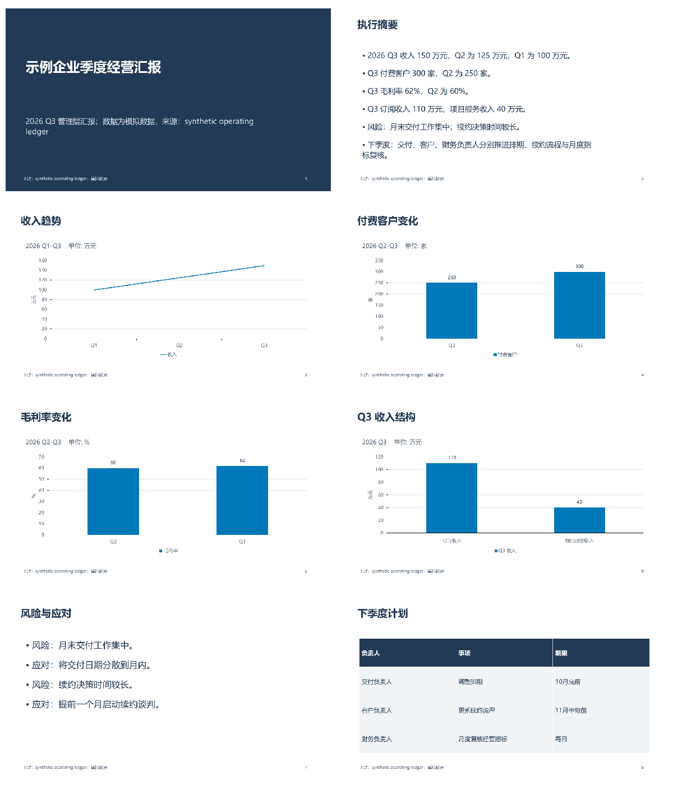
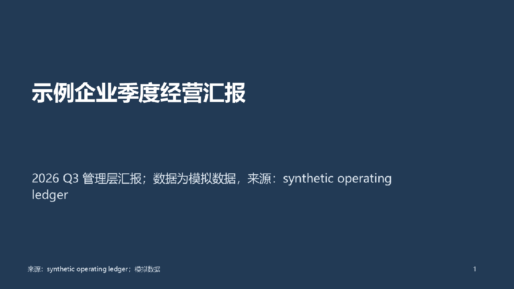
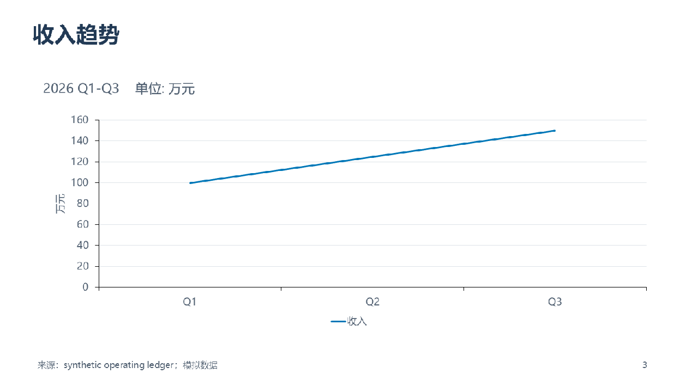
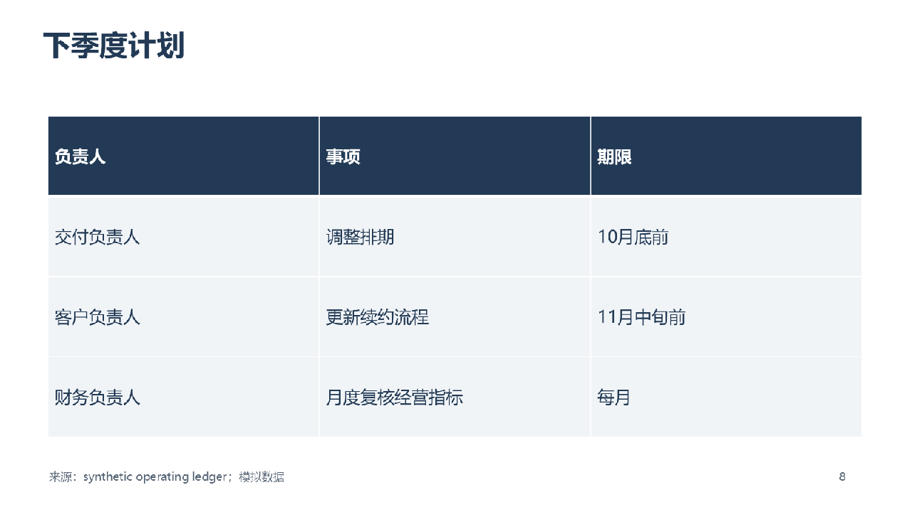
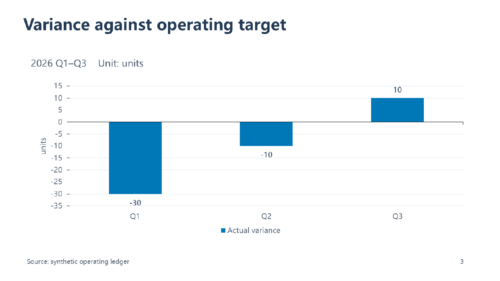

# Local rendered regression gallery

These images come from real Windows PowerPoint exports. All business figures are simulated.
The Chinese report was planned by the configured model from `examples/quarterly_source.md`;
its resulting JSON is retained in `examples/generated/quarterly_model.json`. The English
negative-value example is authored as a contract fixture in `examples/negative_report.json`.

Both passed the relevant editorial checks and measured PowerPoint layout checks locally.
The gallery was visually reviewed for page coverage, legibility and supplied figures; it is
not a general aesthetic or factual certification. Read [quality scopes](../quality.md).

## Eight-page Chinese report

The revised output has one summary, concrete evidence pages, risks and a plan. It does not
include the earlier disclosure-only page or generation instructions in the audience-facing body.



### Cover and typography



### Native editable evidence



### Owner and deadline plan



## English negative values

The chart preserves -30, -10 and 10. Its value axis is not forced to a nonnegative minimum.



## Reproduction

```sh
ppt-generate render examples/generated/quarterly_model.json --output-root outputs --preview-backend powerpoint
ppt-generate render examples/negative_report.json --output-root outputs --preview-backend powerpoint
```

PowerPoint and its fonts are needed to reproduce these previews. The alternative LibreOffice
adapter has a narrower measurement scope and has not been live-tested on this host. These
gallery images are project-generated assets, not third-party Microsoft reference material.
